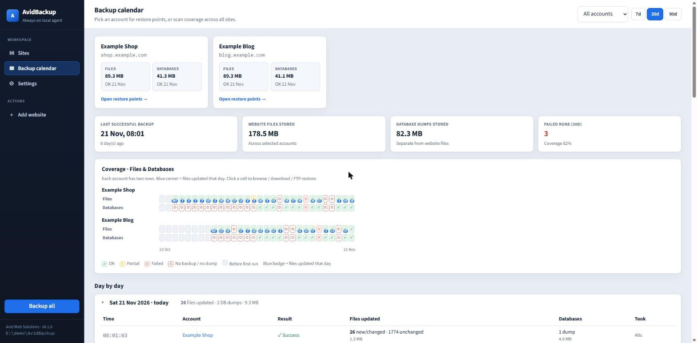
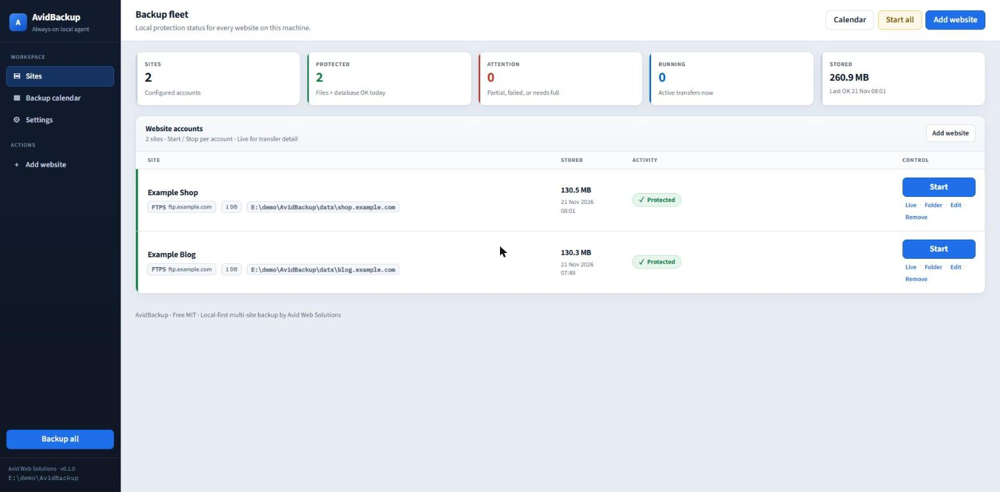
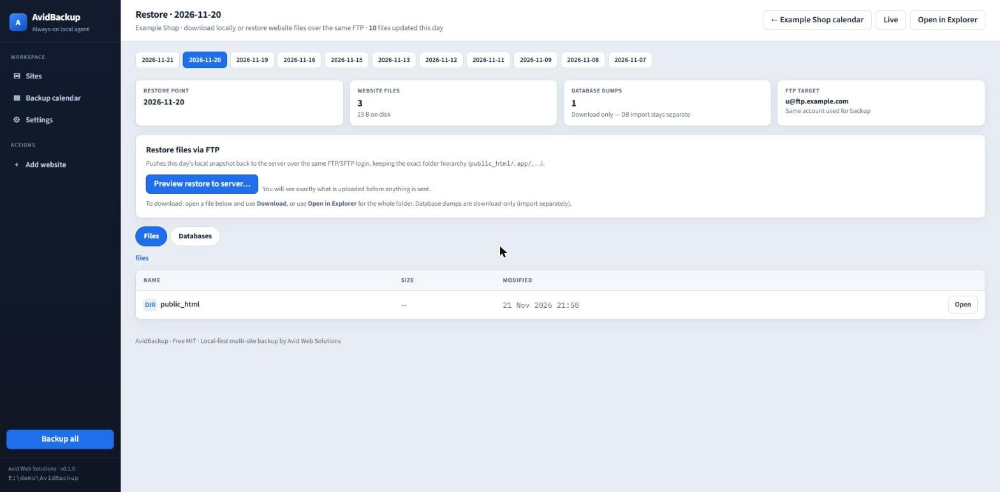
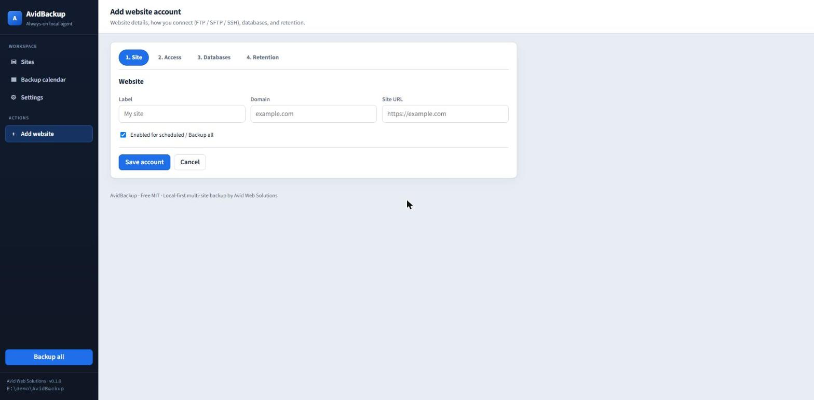
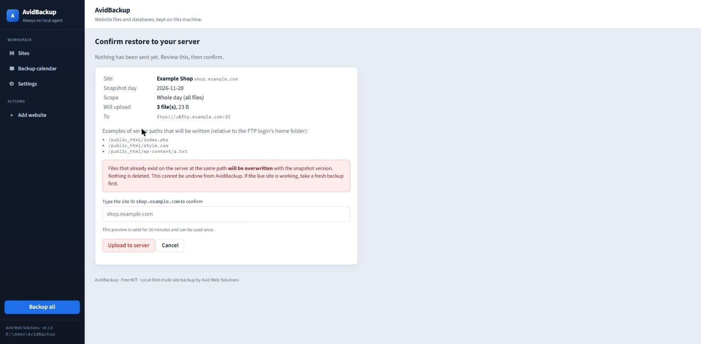

# AvidBackup

**Free, local-first backup for your websites and databases.**
Downloads **only the files that changed** over FTP / FTPS / SFTP, dumps your databases, and keeps every day as a restore point, all on **your own machine**. No cloud, no telemetry.

[](https://github.com/nks16june/avidbackup/actions/workflows/ci.yml)
[](https://github.com/nks16june/avidbackup/releases)
[](LICENSE)
[](https://www.python.org/downloads/)




## Why AvidBackup

- **Only changed files** are downloaded after the first full backup, so daily runs are quick and light on your host.
- **A restore point for every day.** Browse any day's files, download them, or push them back to the server.
- **Your archive is never shortened.** Files deleted on the server stay in your local backup.
- **See at a glance what is protected.** A calendar shows every day per site and flags missed and failed runs.
- **Works with any host** that offers FTP, FTPS or SFTP. No plugin or script needs to be installed on the server.
- **Databases too:** MySQL / MariaDB, PostgreSQL and SQLite, compressed and checksummed.
- **Private by design:** everything stays on your disk. The UI asks for a sign-in, loads nothing from the internet and sends no telemetry.

| Fleet overview | Day-by-day restore points |
|---|---|
|  |  |

## How it works

1. **First run: full backup.** Every file is downloaded once. Incremental mode starts only after a run finishes with zero failures.
2. **Every run after that:** the remote file list is compared with a local manifest and only new or changed files are downloaded (size and modified time).
3. **One folder per day**, `account/YYYY-MM-DD/files` and `/db`. Unchanged files are hard-linked from the previous day (copied where the disk cannot do that), so each day is a complete, restorable snapshot without storing everything again.
4. **Databases are dumped** to the day's `db` folder, compressed, with a `.sha256`, and pruned after your retention period (15 days by default). Website files are kept forever by default.

> Detection uses size and modified time, not file hashes, so a host with unreliable timestamps may re-download more than needed.

## Install

| Platform | How |
|---|---|
| **Windows** | Download `AvidBackup-Setup-*.exe` from the [latest release](https://github.com/nks16june/avidbackup/releases/latest) and run it. No Python needed. Windows SmartScreen may say "unrecognized app" because the installer is not yet code-signed: choose **More info → Run anyway**, and check the published `.sha256` if you like. |
| **Any OS (Python 3.10+)** | `pipx install git+https://github.com/nks16june/avidbackup.git` then `avidbackup app` |
| **Docker** | `docker compose up -d` (needs `AVIDBACKUP_UI_TOKEN`), see [docs/INSTALL.md](docs/INSTALL.md) |
| **From source** | `git clone https://github.com/nks16june/avidbackup.git`, then `pip install -e ".[dev]"` |

**Platform status.** Windows has the installer and is the most tested. Linux and macOS run the same code and pass the automated tests on every push (Ubuntu and macOS, Python 3.10 to 3.12), but they have no installer yet and have had less real-world use, so treat them as **experimental**. The always-on agent is Windows-only for now; on Linux and macOS use cron (`scripts/install_cron.sh`).

## First backup in 5 minutes

1. Start the app: **AvidBackup** from the Start Menu, or `avidbackup app`. Your browser opens and signs you in.
2. Click **Add website**: name, FTP / SFTP login, optional databases. Save.
3. Click **Start** on the site. The first run downloads everything; after that only changes.



Opening the address by hand? Run `avidbackup token` to print your sign-in link.

## Restoring

Open **Backup calendar → a site → a day** to browse that day's files and database dumps. Download what you need, open the folder, or restore files to the server:

- Restoring to the server is a **two-step** action: a preview lists exactly what will be uploaded and where, then you type the site's ID to confirm. The preview is single-use, expires after 10 minutes, and every step is written to an audit log.
- Database dumps are download-only; import them yourself (`avidbackup restore-db` prints the exact command), see [docs/RESTORE.md](docs/RESTORE.md).



## Supported

| | |
|---|---|
| **File transfer** | FTP, FTPS (certificate verified by default), SFTP (host key trust-on-first-use) |
| **Databases** | MySQL / MariaDB, PostgreSQL, SQLite. MySQL uses a built-in Python dump if `mysqldump` is missing. PostgreSQL needs `pg_dump`; on Windows the app can download it for you (about 5 MB, checksum-verified) |
| **Scheduling** | Windows Task Scheduler or the always-on agent; cron on Linux and macOS |
| **Notifications** | Optional: webhook, email, or phone through ntfy (off by default, generic messages unless you opt in) |

## Security and privacy

- **Sign-in required by default.** A random token is generated on first run. The UI only accepts requests addressed to `localhost` (this blocks DNS-rebinding attacks), uses a `SameSite=Strict` cookie and locks out repeated wrong tokens.
- **Nothing leaves your machine.** No telemetry, no cloud, fonts are bundled, phone alerts are opt-in.
- **Passwords are never put on a command line** and are not shown back in the UI.
- **Your credentials live in `accounts.json`**, in plain text. Keep the folder in your user profile or encrypt the disk (see the limits in [docs/SECURITY-MODEL.md](docs/SECURITY-MODEL.md)).

Found a vulnerability? Please report it privately, see [SECURITY.md](SECURITY.md).

## Limitations

- Many **shared hosts block remote MySQL**. Allow your IP in the hosting panel, or database backup will fail while file backup still works.
- The installer is **not code-signed yet** (SmartScreen warning). Linux and macOS have no installer. See the [roadmap](#roadmap).
- Backups are **not encrypted** at rest. Use disk encryption for sensitive sites.

## How it compares

| | |
|---|---|
| Desktop tools (BackupSF, SQLBackupAndFTP) | Often commercial; free tiers commonly capped |
| FTP clients (WinSCP, FileZilla) | Free for files; you script the DB dumps and retention yourself |
| WordPress plugins (UpdraftPlus, Duplicator) | Run on the server, WordPress only, many remote targets paid |
| Hosted services (BlogVault etc.) | Backups are held in their cloud, subscription |
| **AvidBackup** | Free (MIT), any FTP / SFTP site + databases, local-first, no telemetry |

Honest notes and when *not* to use it: [docs/COMPARISON.md](docs/COMPARISON.md).

## Command line

```bash
avidbackup app              # open the UI (tray with the [desktop] extra)
avidbackup run              # back up every enabled site
avidbackup run --account example.com
avidbackup verify           # check files and the newest dumps
avidbackup token            # print the UI sign-in link
avidbackup doctor           # check Python, tools and permissions
avidbackup tools install-postgres   # Windows: fetch pg_dump / psql
```

## Documentation

[Install](docs/INSTALL.md) · [Configuration](docs/CONFIGURATION.md) · [Restore](docs/RESTORE.md) · [Security model](docs/SECURITY-MODEL.md) · [Comparison](docs/COMPARISON.md) · [Packaging](docs/PACKAGING.md) · [Changelog](CHANGELOG.md)

## Roadmap

- [x] MySQL / MariaDB, PostgreSQL, SQLite
- [x] Day-by-day restore points and a coverage calendar
- [ ] Code-signed Windows installer (SignPath) and Microsoft Store listing
- [ ] macOS `.dmg` and Linux AppImage / `.deb`; systemd and launchd agents
- [ ] PHP dump helper and SSH-tunnel assist for hosts without remote MySQL
- [ ] Optional encryption of backups at rest
- [ ] Optional offsite sync (rclone / S3) after a successful local backup
- [ ] MongoDB

## Contributing and support

Bug reports and ideas are welcome: [open an issue](https://github.com/nks16june/avidbackup/issues). See [CONTRIBUTING.md](CONTRIBUTING.md) for how to set up and run the tests. If AvidBackup saves you time, a star helps other people find it.

## About

Built by **[Avid Web Solutions](https://avidwebsolutions.in)** · **Nishant Shrivastava**. Related: **[Avid ERP](https://aviderp.com)**. The multi-site layout is in the spirit of hosting-panel backup managers; AvidBackup is not affiliated with Softaculous.

## License

MIT © Avid Web Solutions / Nishant Shrivastava. Bundled fonts are under the SIL OFL, see [docs/THIRD-PARTY.md](docs/THIRD-PARTY.md).
